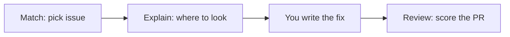

# FirstPR

Helps open-source beginners make their first PR themselves and get it merged.

## Demo

- Live: [https://firstpr-coral.vercel.app](https://firstpr-coral.vercel.app)
- Source: [github.com/nishal21/firstpr](https://github.com/nishal21/firstpr) (AGPL-3.0)
- Demo video: [Watch on Google Drive](https://drive.google.com/file/d/1j-9jqA8RFFG2Gsl4VTEkIREXvPalED7x/view?usp=sharing)
- Deck: [PDF](https://drive.google.com/file/d/1qi0Pkamuqph0TfmOJxtF8G-e31sYm7u5/view?usp=sharing) / [Slides](https://docs.google.com/presentation/d/1mICDKYtFaKD-LwO3PneZDioJY5HwuI8x/edit?usp=sharing)

## Problem statement

Beginners often do not know which issue to take, which files matter, or how to check a PR before a maintainer sees it. Maintainers get incomplete or off-scope first PRs. FirstPR guides the contributor through that path without writing the fix for them.

## Users and context

- Final-year students and fresh graduates in India who need real open-source contributions before placements
- Maintainers who receive those first PRs

## Solution overview

Three steps:

1. **Match** — enter a GitHub username (optional repo). FirstPR picks an open good first issue with no assignee.
2. **Explain** — plain-language summary, real files and line links, hints in three levels. FirstPR refuses to write the fix.
3. **Review** — paste a PR URL or diff. FirstPR scores it against the issue, CONTRIBUTING.md, and the change.



### FirstPRbot on GitHub

Install [FirstPRbot](https://github.com/apps/firstprbot) on a repo:

| Where | Command | What you get |
| --- | --- | --- |
| Issue comment | `/firstpr explain` | Plain-English guide, file permalinks, done-when list, level-1 hint |
| PR comment | `/firstpr review` | Mentor-ready score card (same checklist as the site) |

Opening or pushing to a PR also posts a score card automatically. FirstPRbot never writes the fix.

## Tech stack

- Next.js 16, TypeScript, Tailwind, shadcn/ui
- OpenAI Responses API (model from env, default `gpt-6-luna`)
- Optional Neysa open-model endpoint for file picking
- GitHub REST API via Octokit
- Vercel

## Setup and run

Needs Node 20.9+.

```bash
git clone <this-repo>
cd firstpr
npm install
cp .env.example .env.local
# fill OPENAI_API_KEY, GITHUB_TOKEN, and any optional keys
npm run dev
```

Open [http://localhost:3000](http://localhost:3000).

### Issue search (Algolia)

Optional. If these are unset, the search box keeps using GitHub through `/api/search`.

| Variable | Where it is read | What to set |
| --- | --- | --- |
| `ALGOLIA_APP_ID` | server, index sync | Application ID. The approved Algolia for Open Source app is `VD6Y3O5GB7`. |
| `NEXT_PUBLIC_ALGOLIA_APP_ID` | browser | The same application ID. The dropdown calls Algolia directly, so the browser needs it. |
| `ALGOLIA_ADMIN_KEY` | server only | Admin API key used to write the index. Do not prefix it with `NEXT_PUBLIC_` and do not commit it. |
| `NEXT_PUBLIC_ALGOLIA_SEARCH_KEY` | browser | Search-only API key. |
| `ALGOLIA_INDEX_NAME` | server | Index name. Defaults to `firstpr_issues`. |
| `NEXT_PUBLIC_ALGOLIA_INDEX_NAME` | browser | Only if the index is not `firstpr_issues`. Must match `ALGOLIA_INDEX_NAME`. |
| `CRON_SECRET` | server | Bearer token for `/api/cron/sync-issues`. |

On Vercel, set all of the above in the project environment, then redeploy so the `NEXT_PUBLIC_` values are in the client bundle.

The sync route reads open, unassigned issues labeled `good first issue` or `help wanted`, writes `objectID`, title, repo, url, labels, language, stars, `created_at`, `updated_at`, comments, and assignee status, and deletes ids GitHub now reports as closed or assigned. `vercel.json` schedules that route once a day at 03:00 UTC (`0 3 * * *`). Vercel sends `Authorization: Bearer $CRON_SECRET` when `CRON_SECRET` is set.

First sync, after the variables exist:

```bash
curl -H "Authorization: Bearer $CRON_SECRET" https://firstpr-coral.vercel.app/api/cron/sync-issues
```

Locally, with `npm run dev` and the same variables in `.env.local`:

```bash
curl -H "Authorization: Bearer $CRON_SECRET" http://localhost:3000/api/cron/sync-issues
```

A successful body looks like `{ "ok": true, "indexed": 600, "removed": 0, "complete": false }`. `complete: false` means this run indexed a capped window (6 pages of 100, spaced for GitHub’s search limit) and only removed recently closed or assigned issues. Do not commit real keys.

Offline-style demo (uses committed fixtures under `data/demo/`):

```bash
DEMO_MODE=on npm run dev
```

`DEMO_MODE=auto` (default) uses live APIs and falls back to fixtures on rate limit or timeout. `DEMO_MODE=off` is live only.

### Self-hosting with Postgres (Neon recommended)

By default, FirstPR runs statelessly with an in-memory cache for quick local testing. For self-hosted production deployments on Vercel or Docker (persisting issue explain and review caches across serverless cold starts, FirstPRbot webhook history, and placement-cell cohort analytics), we recommend [Neon Serverless Postgres](https://neon.com):

1. Create a Postgres database on [Neon](https://neon.com).
2. Add your pooled connection string to .env.local as DATABASE_URL=postgresql://...
3. FirstPR uses DATABASE_URL when configured so self-hosted instances persist cached analyses across serverless invocations.

## Models and data

| Task | Model / path |
| --- | --- |
| Explain, hints, difficulty, most JSON | `OPENAI_MODEL` (default `gpt-6-luna`) via Responses API |
| Review | `OPENAI_REVIEW_MODEL` (default `gpt-6-luna`) |
| File picking (optional) | Neysa Gemma then Qwen, then OpenAI `first_pass` fallback |

At request time FirstPR reads public GitHub data through the API. Nothing is stored in a database. The only persisted sample payloads are committed demo fixtures derived from the public MIT-licensed repo [nishal21/NekoDroid](https://github.com/nishal21/NekoDroid).

## Evaluation and guardrails

- Line citations are checked against the real file and dropped if wrong
- The PR score is computed in code from a checklist, not by asking the model for a number
- Deterministic rule checks cannot be overridden by the AI
- Hints refuse code-for-me requests and filter code-like output
- When confidence is low, Explain can include an "unsure" note

## Known limitations and risks

- The AI can still misread an issue
- Only public repos
- Search and GitHub calls are limited by rate limits
- Non-English UI translations were not formally checked
- Most end-to-end testing used one demo repo (NekoDroid)

## Assumptions and trade-offs

- No database and no login
- No streaming responses
- In-memory cache plus recorded demo fixtures for reliability during demos

## Prior work and attribution

Everything in this repo was built during AIBoomi Startup Weekend Kochi (Oct 23–24, 2026). The demo repo nishal21/NekoDroid and its starter issues existed before the event and were declared at kickoff. Built on create-next-app and shadcn/ui.

## How we used AI to build it

We wrote the code with AI coding help in Cursor. We reviewed, tested, and debugged everything ourselves.

## Team

| Name | Role | Contact |
| --- | --- | --- |
| Nishal K | Product, engineering, demo | [@nishal21](https://github.com/nishal21) |
| Anan Shaji | Research, pitch, business | [@zenxrth](https://github.com/zenxrth) |

## License

Dual-licensed under the [GNU Affero General Public License v3.0 (AGPL-3.0)](./LICENSE) (OSI-approved open-source license) and a separate Commercial License for proprietary, internal, or hosted commercial deployments without AGPLv3 source-disclosure obligations. Copyright (c) 2026 Nishal K and Anan Shaji (NKcodex / DuoMatter). For commercial licensing inquiries, contact `nishal@nishal.dev`.
