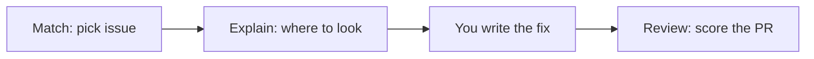

# FirstPR

Helps open-source beginners make their first PR themselves and get it merged.

## Demo

- Live: [https://firstpr.nishal.dev](https://firstpr.nishal.dev)
- Source: [github.com/nishal21/firstpr](https://github.com/nishal21/firstpr) (AGPL-3.0)
- Demo video: [Watch on Google Drive](https://drive.google.com/file/d/1j-9jqA8RFFG2Gsl4VTEkIREXvPalED7x/view?usp=sharing)
- Deck: [PDF](https://drive.google.com/file/d/1qi0Pkamuqph0TfmOJxtF8G-e31sYm7u5/view?usp=sharing) / [Slides](https://docs.google.com/presentation/d/1mICDKYtFaKD-LwO3PneZDioJY5HwuI8x/edit?usp=sharing)

## Problem statement

Beginners often do not know which issue to take, which files matter, or how to check a PR before a maintainer sees it. Maintainers get incomplete or off-scope first PRs. FirstPR guides the contributor through that path without writing the fix for them.

## Users and context

- Final-year students and fresh graduates in India who need real open-source contributions before placements
- Maintainers who receive those first PRs

## Solution overview

Three steps:

1. **Match** — enter a GitHub username (optional repo). FirstPR picks an open good first issue with no assignee.
2. **Explain** — plain-language summary, real files and line links, hints in three levels. FirstPR refuses to write the fix.
3. **Review** — paste a PR URL or diff. FirstPR scores it against the issue, CONTRIBUTING.md, and the change.



### FirstPRbot on GitHub

Install [FirstPRbot](https://github.com/apps/firstprbot) on a repo:

| Where | What happens |
| --- | --- |
| PR opened, reopened, marked ready, pushed to, or its description edited | One summary comment, edited in place on later pushes (edits don't email watchers). Drafts are skipped. |
| PR comment `/firstpr recheck` (or `/firstpr review`) | Re-runs the check now, drafts included |
| Issue comment `/firstpr explain` | Plain-English guide, file permalinks, done-when list, level-1 hint |

The PR summary is written for the maintainer first:

- a one-line verdict: **Ready for review**, **Needs a few changes**, or **Not linked to an issue**
- a short table: linked issue, good-first-issue label, assigned to the author, CONTRIBUTING.md, tests, scope, first-time contributor
- what a maintainer should look at (up to three files or lines)
- up to three next steps for the contributor (never the fix itself)
- the full score in a collapsed `<details>` block, plus a link to the PR on the FirstPR review page

It also sets `firstpr/` labels, each backed by a fact GitHub reports, with a "Labels" section in the comment that says why:

| Label | When |
| --- | --- |
| `firstpr/size: XS` `S` `M` `L` `XL` | Lines added + deleted, not counting lockfiles, `vendor/`, `node_modules/` or generated files (`*.min.js`, `*.map`, `*.pb.go`, ...): under 10, under 30, under 100, under 500, 500+ |
| `firstpr/docs only`, `tests only`, `ci only`, `deps only` | Every changed file is docs (`*.md`, `*.rst`, `docs/`), tests, under `.github/workflows/`, or package manifests plus at least one lockfile |
| `firstpr/linked issue`, `no linked issue` | GitHub's own closing-issue link for the PR (not a text match) |
| `firstpr/checks passing`, `checks failing` | Every check run and status on the latest commit has finished; pending means no label |
| `firstpr/first-time contributor` | GitHub's author association is `FIRST_TIME_CONTRIBUTOR` or `FIRST_TIMER` |

If a fact is missing or unclear (a truncated file list, checks still running, a PR to a non-default branch), the label is left off and the comment says so. FirstPRbot only touches `firstpr/` labels it added itself: a label a maintainer added or removed stays that way. Check labels refresh when checks finish if the App gets **Checks: read** and the **Check suite** and **Status** events; otherwise on the next push or `/firstpr recheck`. Try `node --env-file=.env scripts/verify-auto-labels-live.ts owner/repo#123` to see the labels for a real PR without writing anything.

Older score cards from before this format are collapsed as outdated. Try `node scripts/verify-bot-comment.ts out/` to render three sample comments.

#### Optional `.github/firstpr.yml`

Read from the default branch, so a PR can't change it for itself. Every key is optional.

```yaml
enabled: true              # false stops FirstPRbot commenting on this repo
minimize_old: true         # collapse score cards from the old multi-comment format
require_linked_issue: true # false: a PR without "Fixes #N" can still be "Ready for review"
auto_labels: true          # false, or pick groups: size, area, linked_issue, checks, first_time
labels:                    # off unless you name a label
  first_timer: first-timer # added to PRs from first-time contributors
  needs_issue: needs-issue # added while no issue is linked, removed once one is
```

FirstPRbot never writes the fix.

## Tech stack

- Next.js 16, TypeScript, Tailwind, shadcn/ui
- OpenAI Responses API (model from env, default `gpt-6-luna`)
- Optional Neysa open-model endpoint for file picking
- GitHub REST API via Octokit
- Vercel

## Setup and run

Needs Node 20.9+.

```bash
git clone <this-repo>
cd firstpr
npm install
cp .env.example .env.local
# fill OPENAI_API_KEY, GITHUB_TOKEN, and any optional keys
npm run dev
```

Open [http://localhost:3000](http://localhost:3000).

### Issue search (Algolia)

Optional. If these are unset, the search box keeps using GitHub through `/api/search`.

| Variable | Where it is read | What to set |
| --- | --- | --- |
| `ALGOLIA_APP_ID` | server, index sync | Application ID. The approved Algolia for Open Source app is `VD6Y3O5GB7`. |
| `NEXT_PUBLIC_ALGOLIA_APP_ID` | browser | The same application ID. The dropdown calls Algolia directly, so the browser needs it. |
| `ALGOLIA_ADMIN_KEY` | server only | Admin API key used to write the index. Do not prefix it with `NEXT_PUBLIC_` and do not commit it. |
| `NEXT_PUBLIC_ALGOLIA_SEARCH_KEY` | browser | Search-only API key. |
| `ALGOLIA_INDEX_NAME` | server | Index name. Defaults to `firstpr_issues`. |
| `NEXT_PUBLIC_ALGOLIA_INDEX_NAME` | browser | Only if the index is not `firstpr_issues`. Must match `ALGOLIA_INDEX_NAME`. |
| `CRON_SECRET` | server | Bearer token for `/api/cron/sync-issues`. |

On Vercel, set all of the above in the project environment, then redeploy so the `NEXT_PUBLIC_` values are in the client bundle.

The sync route reads open, unassigned issues labeled `good first issue` or `help wanted`, writes `objectID`, title, repo, url, labels, language, stars, `created_at`, `updated_at`, comments, and assignee status, and deletes ids GitHub now reports as closed or assigned. `vercel.json` schedules that route once a day at 03:00 UTC (`0 3 * * *`). Vercel sends `Authorization: Bearer $CRON_SECRET` when `CRON_SECRET` is set.

Set `GITHUB_SYNC_TOKEN` (a fine-grained, read-only public token) so that sync has its own GitHub rate limit. The sync client is separate from the site client. If `GITHUB_SYNC_TOKEN` is unset, the sync uses `GITHUB_TOKEN`.

Explain, issue, repo, review, and the search fallback use a FirstPRbot installation token when `GITHUB_APP_ID` and `GITHUB_APP_PRIVATE_KEY` are both set. There is no installation-id variable; the app lists its installations and uses the first one. That token is cached until five minutes before it expires. If the app env is unset, or the installation token cannot be minted, those pages use `GITHUB_TOKEN`. An installation token only sees repositories that installation can access.

First sync, after the variables exist:

```bash
curl -H "Authorization: Bearer $CRON_SECRET" https://firstpr.nishal.dev/api/cron/sync-issues
```

Locally, with `npm run dev` and the same variables in `.env.local`:

```bash
curl -H "Authorization: Bearer $CRON_SECRET" http://localhost:3000/api/cron/sync-issues
```

Each run walks GitHub newest to oldest by `created` date, always asking for page 1 of `created:<=cursor`, so GitHub's 1000-result search cap does not apply. The cursor is stored in a separate Algolia index, `<ALGOLIA_INDEX_NAME>_sync_state`, so the next run (daily cron or a manual curl) continues where the last one stopped. A run stops starting new pages after about 250 seconds (the route's `maxDuration` is 300). Each run also drops the most recently closed or assigned issues. When a pass reaches the oldest issue, it deletes records the pass did not see and returns `complete: true`. The next run then starts a new pass.

A body looks like `{ "ok": true, "indexed": 2400, "removed": 37, "complete": false, "rateLimited": false, "debug": { "tokenSource": "sync", "stopReason": "time_budget", ... } }`. `debug` names the credential in use (`sync`, `default`, or `none`, never the value), why the run stopped (`done`, `time_budget`, `rate_limited`, `secondary_limit`, or `busy` when another run holds the lock), the cursor, issues saved in the current pass, and the search and GraphQL budget left. Do not commit real keys.

Offline-style demo (uses committed fixtures under `data/demo/`):

```bash
DEMO_MODE=on npm run dev
```

`DEMO_MODE=auto` (default) uses live APIs and falls back to fixtures on rate limit or timeout. `DEMO_MODE=off` is live only.

### Self-hosting with Postgres (Neon recommended)

By default, FirstPR runs statelessly with an in-memory cache for quick local testing. For self-hosted production deployments on Vercel or Docker (persisting issue explain and review caches across serverless cold starts, FirstPRbot webhook history, and placement-cell cohort analytics), we recommend [Neon Serverless Postgres](https://neon.com):

1. Create a Postgres database on [Neon](https://neon.com).
2. Add your pooled connection string to .env.local as DATABASE_URL=postgresql://...
3. FirstPR uses DATABASE_URL when configured so self-hosted instances persist cached analyses across serverless invocations.

## Models and data

| Task | Model / path |
| --- | --- |
| Explain, hints, difficulty, most JSON | `OPENAI_MODEL` (default `gpt-6-luna`) via Responses API |
| Review | `OPENAI_REVIEW_MODEL` (default `gpt-6-luna`) |
| File picking (optional) | Neysa Gemma then Qwen, then OpenAI `first_pass` fallback |

At request time FirstPR reads public GitHub data through the API. Nothing is stored in a database. The only persisted sample payloads are committed demo fixtures derived from the public MIT-licensed repo [nishal21/NekoDroid](https://github.com/nishal21/NekoDroid).

## Evaluation and guardrails

- Line citations are checked against the real file and dropped if wrong
- The PR score is computed in code from a checklist, not by asking the model for a number
- Deterministic rule checks cannot be overridden by the AI
- Hints refuse code-for-me requests and filter code-like output
- When confidence is low, Explain can include an "unsure" note

## Known limitations and risks

- The AI can still misread an issue
- Only public repos
- Search and GitHub calls are limited by rate limits
- Non-English UI translations were not formally checked
- Most end-to-end testing used one demo repo (NekoDroid)

## Assumptions and trade-offs

- No database and no login
- No streaming responses
- In-memory cache plus recorded demo fixtures for reliability during demos

## Prior work and attribution

Everything in this repo was built during AIBoomi Startup Weekend Kochi (Oct 23–24, 2026). The demo repo nishal21/NekoDroid and its starter issues existed before the event and were declared at kickoff. Built on create-next-app and shadcn/ui.

## How we used AI to build it

We wrote the code with AI coding help in Cursor. We reviewed, tested, and debugged everything ourselves.

## Team

| Name | Role | Contact |
| --- | --- | --- |
| Nishal K | Product, engineering, demo | [@nishal21](https://github.com/nishal21) |
| Anan Shaji | Research, pitch, business | [@zenxrth](https://github.com/zenxrth) |

## License

Dual-licensed under the [GNU Affero General Public License v3.0 (AGPL-3.0)](./LICENSE) (OSI-approved open-source license) and a separate Commercial License for proprietary, internal, or hosted commercial deployments without AGPLv3 source-disclosure obligations. Copyright (c) 2026 Nishal K and Anan Shaji (NKcodex / DuoMatter). For commercial licensing inquiries, contact `nishal@nishal.dev`.
